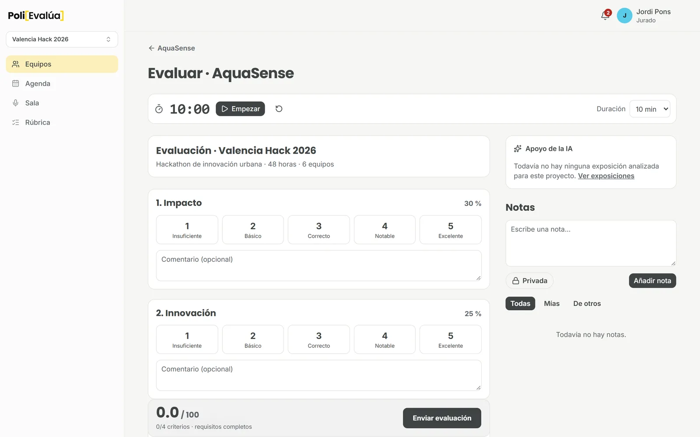
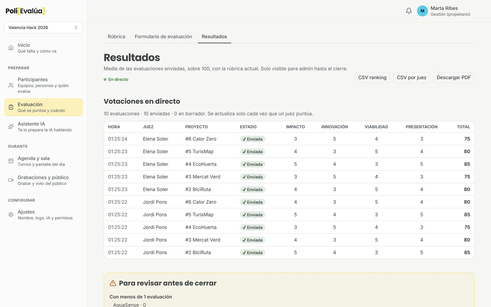
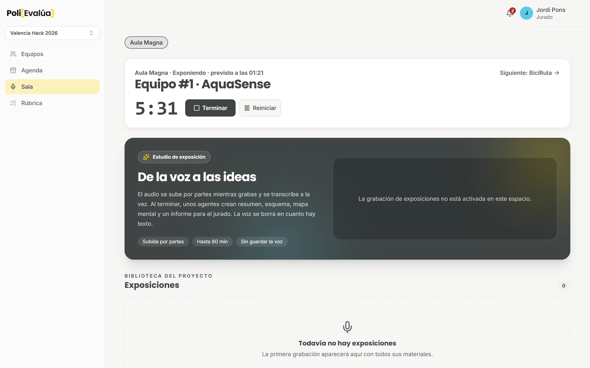
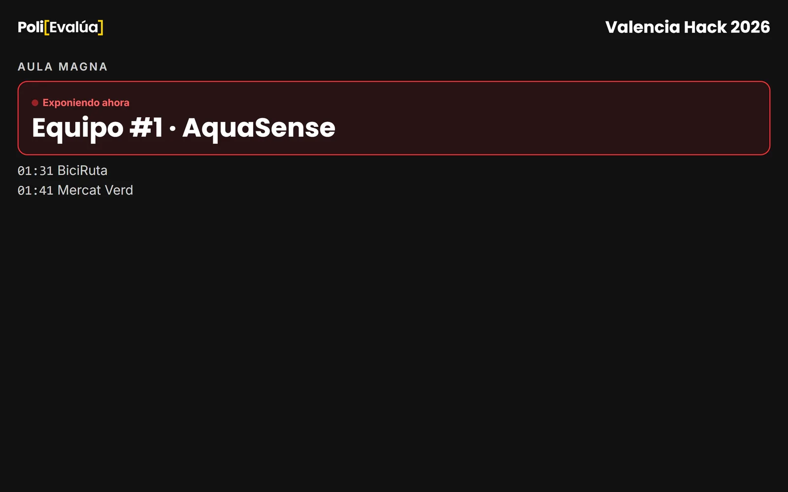
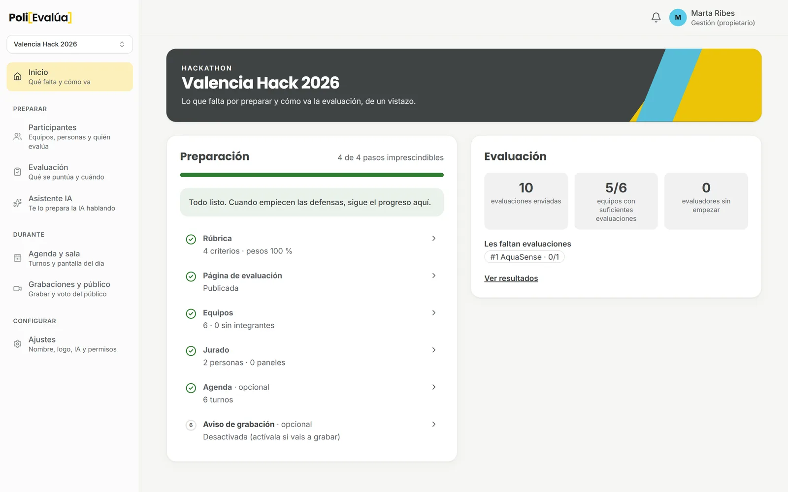
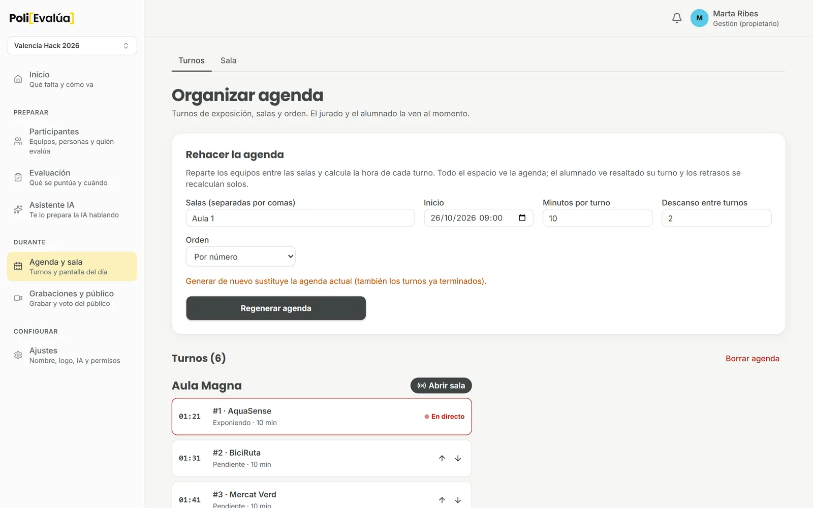
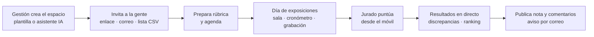
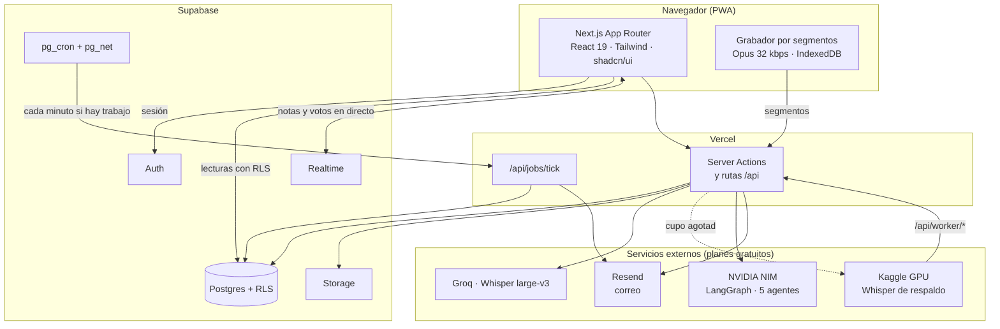
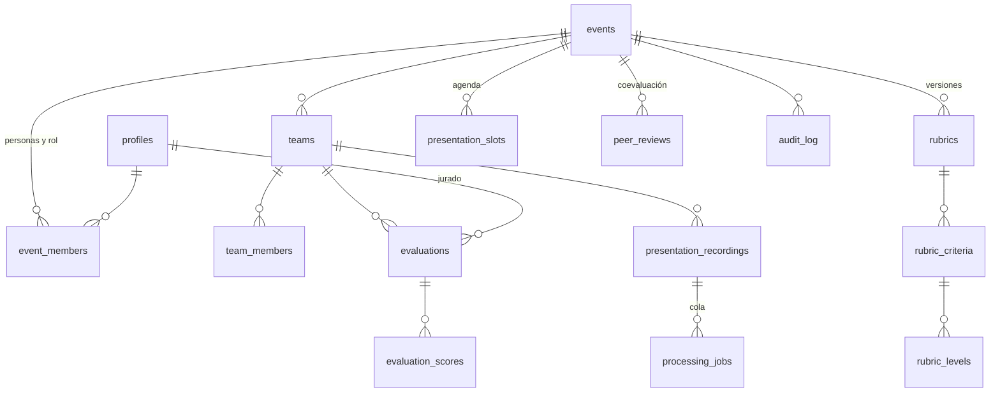
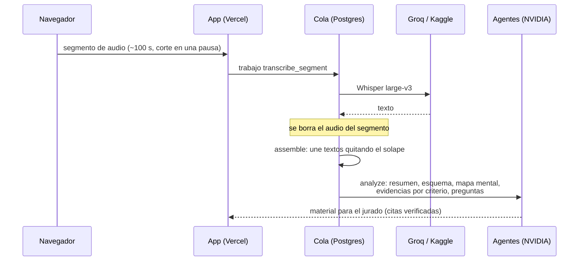

<div align="center">

<a href="https://polievalua.tech"></a>

<h1>
<picture>
  <source media="(prefers-color-scheme: dark)" srcset="docs/brand/wordmark-dark.png">
  
</picture>
</h1>

**Evalúa hackathons y clases sin papeles ni hojas de cálculo.**

Rúbricas, jurado en directo, coevaluación, agenda de exposiciones y
transcripción con IA en una sola plataforma. Gratis, accesible y de código abierto.

[**polievalua.tech**](https://polievalua.tech) ·
[Funciones](#funciones) ·
[Arquitectura](#arquitectura) ·
[Instalación](#instalación) ·
[Contribuir](CONTRIBUTING.md)




</div>

> Proyecto independiente de código abierto nacido para València Hack y
> generalizado para cualquier actividad evaluable. **No es un servicio oficial
> de la Universitat Politècnica de València.**

## Índice

- [Funciones](#funciones)
- [Capturas y vídeo](#capturas-y-vídeo)
- [Cómo se usa](#cómo-se-usa)
- [Arquitectura](#arquitectura)
- [Modelo de datos](#modelo-de-datos)
- [Grabación, transcripción e IA](#grabación-transcripción-e-ia)
- [Avisos por correo](#avisos-por-correo)
- [Seguridad y privacidad](#seguridad-y-privacidad)
- [Instalación](#instalación)
- [Variables de entorno](#variables-de-entorno)
- [Pruebas](#pruebas)
- [Estructura del repositorio](#estructura-del-repositorio)
- [Licencia](#licencia)

## Funciones

| | Función | Qué hace |
|---|---|---|
| 🏗️ | **Espacios** | Cada hackathon, asignatura, premio o proyecto es un espacio aislado con sus personas, equipos, rúbrica, imagen y resultados. Plantillas por tipo y un asistente con IA que lo prepara a partir de una descripción. |
| 👥 | **Roles** | Propietario, gestión, jurado, mentor, docente, alumnado, revisor y consulta. Invitaciones personales por enlace o correo, código de acceso e importación de la lista de PoliformaT (CSV). |
| 📋 | **Rúbricas** | Criterios con peso, niveles descritos con ejemplos, preguntas y requisitos. Nota sobre 100 al momento, autoguardado y cambios versionados (las evaluaciones antiguas conservan su rúbrica). |
| ⚖️ | **Jurado** | Tribunales con reparto de proyectos por rondas, notas privadas o compartidas en tiempo real y cronómetro de exposición. |
| 📊 | **Resultados** | Votaciones en directo, ranking, discrepancias entre jueces, equipos con pocas notas y exportación a CSV y PDF. Publicación de nota y comentarios al alumnado. |
| 🔁 | **Coevaluación** | Evaluación entre grupos y autoevaluación, siempre anónima, con reparto automático. |
| 🗓️ | **Agenda y sala** | Turnos por sala generados solos, reordenables, modo sala para quien dirige y modo proyector para la pantalla grande. |
| 🎙️ | **Grabación + IA** | La exposición se graba por segmentos, se transcribe con Whisper y cinco agentes preparan resumen, esquema, mapa mental, evidencias por criterio y preguntas. **El audio se borra al transcribirse**; el texto, N meses después de cerrar el espacio. |
| 🗳️ | **Voto del público** | Votación abierta con enlace o QR para el público asistente. |
| 🔔 | **Avisos** | Campana en la app con lo pendiente y correos de invitación, «expones en 10 minutos» y «resultados publicados». Cada persona puede darse de baja. |
| 🌍 | **Idiomas** | Castellano, valencià e English en toda la interfaz; transcripción con detección automática del idioma. |
| ♿ | **Accesibilidad** | Auditada con axe (WCAG 2.1 AA) en 29 páginas en modo claro y oscuro; enlace para saltar al contenido. |
| 📱 | **App instalable** | PWA: se instala en el móvil como una app. |
| 🧾 | **Auditoría** | Registro de cada acción de gestión. |

## Capturas y vídeo

| Evaluar | Resultados en directo |
|---|---|
|  |  |
| **Sala del día** | **Modo proyector** |
|  |  |
| **Panel de gestión** | **Agenda** |
|  |  |

🎬 **Vídeo de presentación:** [public/showcase/promo.mp4](public/showcase/promo.mp4). Se monta con código en [`video/`](video/) (Remotion) y lleva música original sintetizada: `cd video && npm install && npm run render`.
(también en la [portada](https://polievalua.tech/#demo)).

Todas las imágenes y el vídeo se generan solos con `npm run showcase`, que crea
un hackathon de demostración temporal, lo recorre con Playwright y lo borra.

## Cómo se usa



## Arquitectura



**Principios**

- **La base de datos manda.** La separación entre espacios y la privacidad se
  imponen en Postgres (RLS, claves foráneas compuestas y funciones
  `SECURITY DEFINER` con comprobación de rol), no solo en la interfaz.
- **Servidor primero.** Las páginas son componentes de servidor y los cambios
  pasan por Server Actions validadas con Zod.
- **Coste cero.** Todo funciona en los planes gratuitos de Vercel, Supabase,
  Groq, NVIDIA, Kaggle y Resend.
- **Degradación suave.** Si falta una clave (IA, correo, transcripción), esa
  función se desactiva y el resto sigue funcionando.

## Modelo de datos



Las migraciones de `supabase/migrations/` describen el esquema completo,
paso a paso.

## Grabación, transcripción e IA



Detalle completo en [docs/AI_ARCHITECTURE.md](docs/AI_ARCHITECTURE.md). La IA
**nunca pone notas**: solo prepara material de apoyo y la nota la decide una
persona.

## Avisos por correo

| Aviso | Cuándo | A quién |
|---|---|---|
| Invitación | Al crear una invitación | La persona invitada |
| Tu turno | 5, 10, 15 o 30 min antes (lo elige la gestión) | Integrantes del equipo |
| Resultados | La primera vez que se publican | Alumnado del espacio |

Se envían con [Resend](https://resend.com) desde el pulso de la cola
(`pg_cron` → `/api/jobs/tick`), una sola vez cada uno (`email_log`), y respetan
la baja de cada perfil.

## Seguridad y privacidad

- RLS en todas las tablas; pruebas automáticas de aislamiento entre espacios
  (`npm run test:security`).
- Claves de servicio e IA solo en el servidor.
- Al modelo de IA no se le envían listas de participantes ni evaluaciones.
- Audio sin conservar; transcripciones con plazo de borrado configurable.
- Aviso de grabación que cada persona confirma antes de entrar.

Consulta [SECURITY.md](SECURITY.md) para comunicar una vulnerabilidad.

## Instalación

Requisitos: Node.js 22+, npm 10 y un proyecto de Supabase.

```bash
git clone https://github.com/cofrian/PoliEvalua.git
cd PoliEvalua
npm ci
cp .env.example .env.local          # rellénalo con tus claves
npx supabase link --project-ref TU_PROJECT_REF
npx supabase db push                # aplica las migraciones
npm run dev                         # http://localhost:3000
```

Para producción basta con importar el repositorio en Vercel, copiar las
variables y apuntar `NEXT_PUBLIC_SITE_URL` a tu dominio. El trabajador de
transcripción de respaldo está en [worker/](worker/README.md).

## Variables de entorno

| Variable | Dónde | Para qué |
|---|---|---|
| `NEXT_PUBLIC_SUPABASE_URL` | Cliente | URL del proyecto Supabase |
| `NEXT_PUBLIC_SUPABASE_ANON_KEY` | Cliente | Clave pública limitada por RLS |
| `SUPABASE_SERVICE_ROLE_KEY` | Servidor | Operaciones administrativas verificadas |
| `NEXT_PUBLIC_SITE_URL` | Cliente | URL pública (enlaces de los correos) |
| `NVIDIA_API_KEY` | Servidor | Asistente y agentes de IA |
| `GROQ_API_KEY` | Servidor | Transcripción con Whisper |
| `RESEND_API_KEY` | Servidor | Envío de correos |
| `EMAIL_FROM` | Servidor | Remitente (por defecto `PoliEvalúa <avisos@polievalua.tech>`) |
| `JOBS_CRON_SECRET` | Servidor | Secreto del pulso de la cola |
| `TRANSCRIPTION_WORKER_TOKEN` | Servidor | Trabajadores Whisper de respaldo |

La lista completa, con las opcionales, está comentada en
[.env.example](.env.example).

## Pruebas

```bash
npm run test:ci        # mensajes, lint, tipos y build
npm run test:security  # RLS y aislamiento entre espacios (Supabase real)
npm run test:e2e       # Playwright de punta a punta, incluida auditoría axe
npm run showcase       # regenera capturas y vídeo
```

Las pruebas que usan Supabase crean datos temporales `@test.local` y los
borran al terminar. No las lances contra un proyecto ajeno.

## Estructura del repositorio

```
src/app/            Rutas (App Router): (app) interna, (auth), (platform), api
src/components/     Interfaz: app/, ui/ (shadcn), brand/
src/lib/app/        Lógica de dominio: sesión, agenda, cola, avisos, resultados
src/lib/ai/         Modelos y agentes LangGraph
messages/           Traducciones es · ca · en
supabase/           Migraciones SQL y configuración
worker/             Transcriptor Whisper de respaldo (Kaggle, Colab, Docker)
e2e/                Pruebas Playwright y generador de capturas
docs/               Arquitectura de IA, plan, pruebas y revisiones
```

## Licencia

Código bajo licencia [MIT](LICENSE). Los nombres, marcas y logotipos de cada
organización (incluidos los de la UPV y los patrocinadores) pertenecen a sus
titulares y no quedan cubiertos por esa licencia.

## Marca

Los logos están en [`docs/brand/`](docs/brand) y se regeneran con `node scripts/brand-assets.mjs`:

| Archivo | Uso |
|---|---|
| `wordmark-light.png` / `wordmark-dark.png` | Logo Poli[Evalúa] sobre fondo claro u oscuro |
| `icon.svg` / `icon-512.png` | Icono de la aplicación |
| `social-preview.png` | Imagen al compartir el repositorio (1280×640) |

PoliEvalúa es un proyecto independiente; no es un servicio oficial de la Universitat Politècnica de València.
